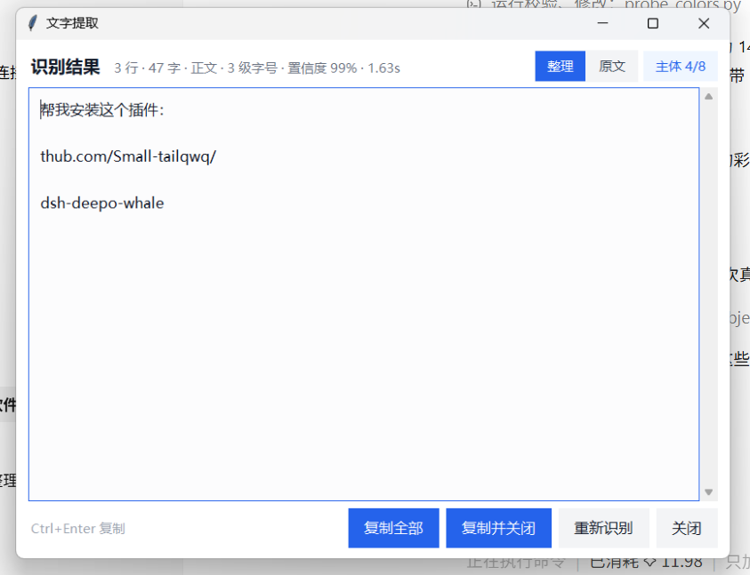
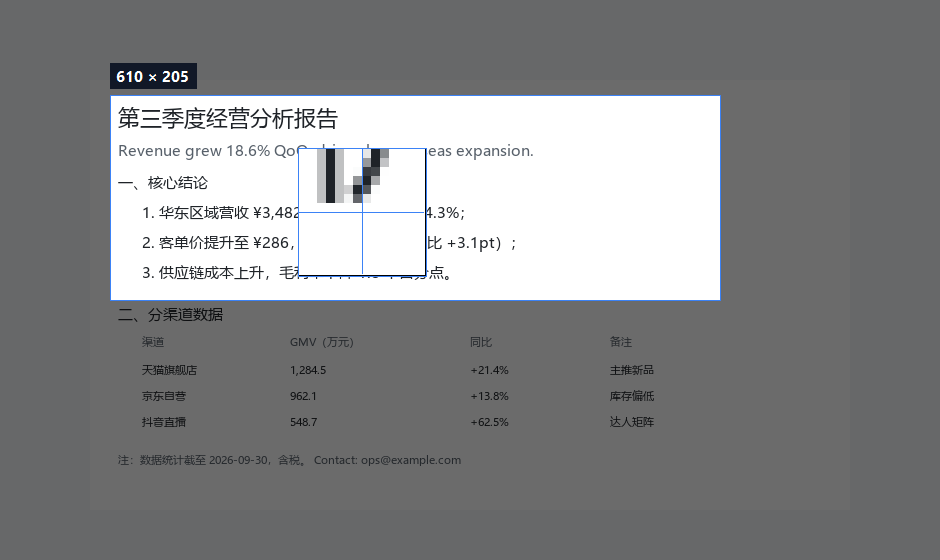
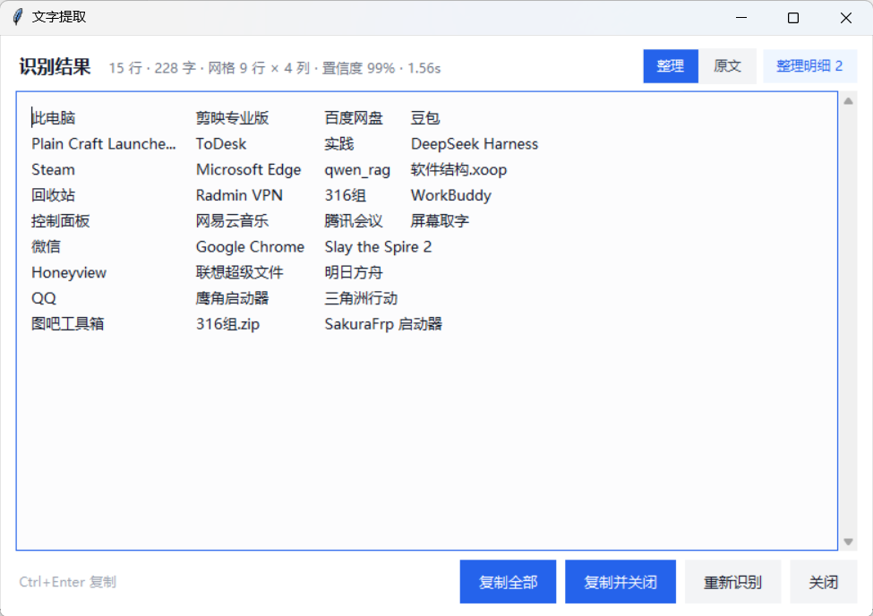
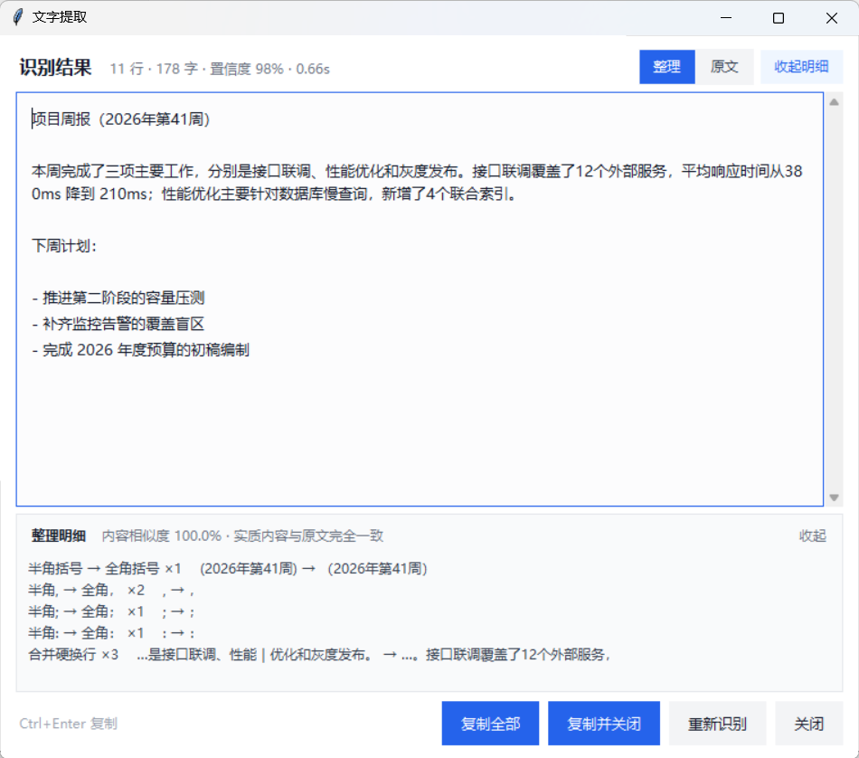
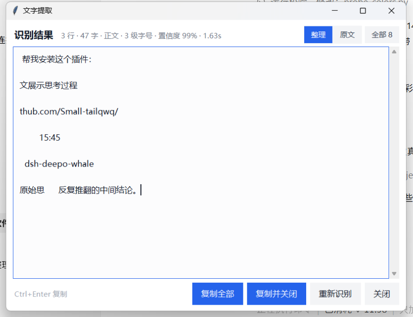

# NineOne Spirits (九一的酒)

**Screen text capture · TextGrabber**

[English](README.md) · [简体中文](README.zh-CN.md) · [Website](https://nineone-spirits.github.io/textgrabber/)

[](LICENSE)
[](https://www.python.org/downloads/)
[](#requirements)
[](#privacy)
[](CHANGELOG.md)

Press one hotkey, drag a box over any window, webpage or PDF, and get the text inside —
**only the text you actually want**. Recognition runs locally, results are readable as-is,
editable and copyable in one click. Nothing leaves your machine.



## The problem it solves

Grabbing text off the screen is easy. Getting text you can *use* is not. Most tools fail in three places:

1. **They capture the wrong layer.** A headline sits on top of a page with its own body text; both get recognized and interleaved into one line of noise.
2. **Layout is lost.** Tables collapse into a single column, two-column text reads across, headings fuse into the paragraph below.
3. **You have to clean up afterwards.** Paragraphs broken by the window width, stray spaces between CJK characters, half-width punctuation mixed with full-width.

The same region, before and after 1.3.0:

<table>
<tr><th width="50%">1.2.0 output (one line, 122 chars)</th><th width="50%">1.3.0 output (3 lines, 47 chars)</th></tr>
<tr><td><code>github.com/Small-tailqwq/对话用中文展示思考过程轨迹帮我安装这个插件： dsh-deep直接展示后面合温导现能物的是给出结构化的推 o-whale提，判断体据，备选方案为什么选它原始思到全的疑点 反复推翻的中间结论。15:45</code></td>
<td><code>帮我安装这个插件：<br>github.com/Small-tailqwq/<br>dsh-deep-whale</code></td></tr>
</table>

## Features

**Capture**

- Global hotkey `Ctrl+Alt+Q`, works over any application; `Ctrl+Alt+D` re-reads the last region (handy when content scrolls or refreshes)
- 9× magnifier follows the cursor, live pixel size in the corner of the selection
- Correct on multi-monitor setups, negative coordinates and 100% / 125% / 150% scaling

**Subject text filter**

- Decides which layer is the subject by **font size × ink chroma**, then drops the background text sitting under it
- The `Subject 3/8` button in the result window switches back to all text, so nothing is hidden from you
- Can be pinned to a colour (`subject_filter: red`) or turned off entirely

**Layout reconstruction**

- Desktop icon grids and parameter tables are emitted in their original column positions, aligned with tabs rather than padded spaces
- Multi-column prose is read column by column instead of across
- Pages with several font sizes are split into levels; headings stay separate from body text

**Text tidying**

- Merges hard wraps caused by window width, normalizes punctuation, removes noise spaces between CJK characters, re-blocks headings and lists
- Conservative correction only: repeated characters, digit confusions, and 24 high-confidence typo rules. No near-miss character substitution, no cloud model rewriting your text
- Every change is counted and sampled, with a content-similarity check; switch back to the raw lines at any time

**Privacy**

- Recognition is fully local — **no network, no uploads**
- No keyboard logging, no process injection, no reading other applications' memory
- Configuration lives in `%APPDATA%\TextGrabber\config.json`

## Screenshots

| Selection overlay with magnifier | Grid / table reconstruction |
| --- | --- |
|  |  |

| Change log of the tidying pass | All text (click `Subject 3/8`) |
| --- | --- |
|  |  |

## Quick start

### Requirements

| Item | Requirement |
| --- | --- |
| OS | Windows 10 / 11 (`RegisterHotKey` and GDI capture are Win32-only; **macOS and Linux are not supported**) |
| Python | 3.10+, with `tkinter` (bundled in the python.org installer) |
| Disk | About 300 MB (dependencies are ~110 MB) |
| GPU | Not required; CPU inference, ~0.4 s per screenshot, 2–3 s warm-up on first launch |

Check your interpreter:

```bat
python -c "import tkinter; print('ok')"
```

### Install

**Option 1 — one-click script (recommended)**

```bat
git clone https://github.com/nineone-spirits/textgrabber.git
cd textgrabber
install.bat
```

The script probes `py -3`, every `python` on `PATH`, then the usual install locations,
and requires `tkinter` in the candidate it picks. It then creates `.venv` and installs dependencies
(~110 MB, via the Tsinghua mirror by default).

To use another index: `set TEXTGRABBER_PIP_INDEX=https://pypi.org/simple` before running.
To skip the mirror entirely: `set TEXTGRABBER_NO_MIRROR=1`.

**Option 2 — pip install (usable as a package)**

```bat
git clone https://github.com/nineone-spirits/textgrabber.git
cd textgrabber
py -3 -m venv .venv
.venv\Scripts\python -m pip install -e .
```

This creates `.venv\Scripts\textgrabber.exe` (a `gui-scripts` entry point with no console window).
`python -m screengrab` works too.

**Option 3 — no install**

With the dependencies present (`pip install -r requirements.txt`) you can run `python run.py` straight from the clone.

### Run

```bat
run.bat                        :: recommended: verifies dependencies, then launches
.venv\Scripts\pythonw run.py   :: no console
.venv\Scripts\python  run.py   :: keeps the console, so you can see errors
```

A blue **OCR** pill appears in the bottom-right corner when the app is ready.
No pill means it failed to start — run it with the console to see the traceback.

The OCR model is warmed up on first launch (2–3 s); after that the hotkey feels instant.

### Two optional tweaks

**Start with Windows**: put a shortcut to the launcher in
`%APPDATA%\Microsoft\Windows\Start Menu\Programs\Startup`.

**Desktop icon / taskbar pin**: create a shortcut to `.venv\Scripts\pythonw.exe`,
pass `run.py` (full path) as the argument, set the working directory to the project folder,
and pick `icon.ico`. Windows shortcuts store absolute paths, so rebuild them if you move the project.

## Usage

| Action | How |
| --- | --- |
| Capture text | `Ctrl+Alt+Q`, or click the pill |
| Re-run the last region | `Ctrl+Alt+D` |
| Cancel a selection | `Esc` / right click / click without dragging |
| Copy | `Ctrl+Enter` copies everything, `Ctrl+C` copies the selection, or click `Copy all` |
| See the raw output | `Raw` in the top right of the result window |
| See what changed | `Changes N` expands counts and before/after samples per rule |
| Subject only | On by default; `Subject 3/8` switches back to all text |
| Re-layout | `Layout: lines / paragraph` in the raw view — re-flows without re-running OCR |
| Quit | Pill context menu → Quit |

Typical uses:

- **Copy a headline from a video**: drag over the text; the page text behind it is filtered out
- **Copy a table from a PDF**: output is tab-aligned, so it splits into columns when pasted into Excel
- **Copy an error message**: drag over the console, `Ctrl+Enter`, done
- **Edit while comparing**: fix the text directly in the result window, then copy

## Configuration

`%APPDATA%\TextGrabber\config.json` (created on first run; restart after editing)

| Key | Default | Description |
| --- | --- | --- |
| `hotkey` | `ctrl+alt+q` | Capture hotkey; must include ctrl/alt/shift/win |
| `hotkey_retry` | `ctrl+alt+d` | Re-read the last region |
| `layout_mode` | `verbatim` | `verbatim` keeps line breaks, `paragraph` re-flows |
| `tidy_enabled` | `true` | Run the tidying pass after recognition |
| `result_view` | `tidy` | Default view: `tidy` or `raw` |
| `subject_filter` | `auto` | `auto` / `off` / `large` / `red` / `color:blue` |
| `min_score` | `0.5` | Drop boxes below this confidence |
| `auto_invert` | `true` | Invert dark themes before recognition |
| `pill_pos` | `null` | Pill position, saved after dragging |
| `last_region` | `null` | Last selection, used by the re-read hotkey |

If the hotkey is already taken by another app, a toast appears at startup; change the value and restart.

## Project layout

```
screengrab/
  main.py            Entry: DPI awareness → single instance → launch
  app.py             State machine and threading (hotkey → capture → select → OCR → subject → result)
  winutil.py         Win32 glue: DPI, window placement, monitors, single instance, clipboard
  hotkey.py          Global hotkeys (RegisterHotKey + dedicated message loop)
  capture.py         Desktop capture (virtual screen coordinate math)
  overlay.py         Selection overlay (one window per monitor, dim + brighten, magnifier, size label)
  ocr.py             Recognition service (pluggable backends, invert/BGR preprocessing, score filter)
  subject.py         Subject filter (ink colour sampling, size band, colour convergence, rule parsing)
  structure.py       Structure analysis (column candidates, row signatures, blocks, cells, size levels)
  layout.py          Layout reconstruction (dispatch per block: grid / columns / prose)
  tidy.py            Text tidying (normalize, punctuation, spacing, re-wrap, re-block, safe corrections)
  pill.py            Floating pill
  result_window.py   Result window (tidied/raw views, change log, subject toggle, wrapping, copy)
  config.py          Configuration read/write
run.py               Launcher (same as python -m screengrab)
install.bat          Create .venv and install dependencies
run.bat              Check dependencies, then launch
docs/技术方案.html    Technical design document (Chinese; selection rationale, algorithms, measurements)
tests/               Ten standalone test scripts (structure / tidy / subject / layout / GUI / end-to-end)
```

## Development

```bat
.venv\Scripts\python -m pip install -e .
.venv\Scripts\python tests\test_structure.py   :: 36 assertions: icon grid, table, columns, size levels
.venv\Scripts\python tests\test_tidy.py        :: 38 assertions: re-wrap, punctuation, spacing, fidelity
.venv\Scripts\python tests\test_subject.py     :: 47 assertions: colour families, size band, sampling, e2e
.venv\Scripts\python tests\test_pipeline.py    :: layout units + synthetic UI end-to-end
.venv\Scripts\python tests\test_grid_e2e.py    :: real desktop screenshot (captures your screen)
.venv\Scripts\python tests\test_tidy_e2e.py    :: synthetic narrow column → OCR → tidying
.venv\Scripts\python tests\test_result_wrap.py :: result window wrapping and narrow layouts
.venv\Scripts\python tests\test_result_tidy.py :: view switching, change panel, no overflow
.venv\Scripts\python tests\test_gui_smoke.py   :: GUI smoke (clipboard, overlay, widgets)
.venv\Scripts\python tests\test_app_e2e.py     :: full loop (hotkey → capture → OCR → clipboard)
```

`test_pipeline.py` prints recognition output for light, dark and small-text UIs so you can eyeball accuracy;
`test_tidy.py` prints before/after text.

Contribution workflow, code map and style notes are in [CONTRIBUTING.md](CONTRIBUTING.md).

## FAQ

**Double-clicking does nothing / there is no pill?**
It failed to start. Run `.venv\Scripts\python run.py` to see the error. The usual causes are missing
dependencies (`No module named rapidocr`) or an interpreter without `tkinter`.

**The hotkey does nothing?**
Another app (screenshot tool, recorder, IDE) probably owns it — a toast appears at startup.
Change `hotkey` in `config.json`, or click the pill.

**I get a black rectangle instead of the window content?**
Hardware-accelerated or DRM-protected windows can't be captured by GDI (some players, protected streams,
exclusive fullscreen games). Switch the window out of exclusive mode. A real fix needs Windows Graphics Capture — see the roadmap.

**Does it work offline? Can I use it commercially?**
Fully offline; models ship with the dependency. MIT licence: commercial use and closed-source redistribution are fine, keep the copyright notice.

## Known limitations

- **Windows only**: `RegisterHotKey` / `SetWindowPos` / GDI capture are Win32-specific.
- **Uncapturable content**: hardware-accelerated or DRM-protected windows come out black.
- **Weak at**: handwriting, stylized display type, vertical Chinese, rotation beyond 15°, text below 8 px, very low contrast.
- **Text layer only**: line breaks, blank lines, indentation and tab alignment are preserved; fonts, weights and colours are not, and merged table cells are lost.
- **Columns depend on detected boxes**: if OCR merges several cells into one box, the split is a best guess.
- **The subject filter only looks at size and colour**: it does not read content, so a poster where everything is large and colourful won't trigger filtering; white text on dark themes is greyscale and is separated by size alone.
- The result window is always-on-top, so it can be covered by exclusive fullscreen apps.

The complete list of risks and trade-offs is in [docs/技术方案.html](docs/技术方案.html) (Chinese), section 13.

## Roadmap

Evaluated items (a "conflict" means the item contradicts a deliberate design choice and needs a decision, not just work):

| Item | Value | Cost | Constraint / risk | Status |
| --- | --- | --- | --- | --- |
| Switch capture to Windows Graphics Capture | High: fixes black frames on accelerated windows | Large: interop layer + D3D11 frame readback, 400–600 lines, needs protected windows to verify | GDI capture underpins every coordinate calculation; the whole capture test set must be rerun | Planned |
| Tray icon + settings window | High: no more hand-editing JSON | Medium: `Shell_NotifyIcon` (ctypes) + Tk dialog, 300–400 lines | Touches process lifetime; "closing the window must not quit" has to hold | Planned |
| Standalone single-file exe | Medium: non-technical users | Medium: PyInstaller spec + build script, 120–180 MB artifact | Cannot live in the repo, Release attachment only; model files need `collect-data` | Planned |
| Table structure recognition (PP-Structure) | Medium: Markdown/HTML tables | Large: extra model (hundreds of MB) | **Conflict**: contradicts "models ship with the package, four light dependencies, fully offline" | Needs decision |
| Semantic tidying with a local model | Low: current rules cover the common cases | Large: GB-scale dependency + latency | **Conflict**: contradicts the promise of never rewriting content | Needs decision |

Order of work: additive features that keep the current contract first (tray, exe), then capabilities that
require rewriting the base (WGC), and only then big-model directions — the last ones have to be worth
giving up "offline + lightweight" for.

## Contributing

Issues and pull requests are welcome. Read [CONTRIBUTING.md](CONTRIBUTING.md) first;
by participating you agree to the [Code of Conduct](CODE_OF_CONDUCT.md).
Changes are recorded in [CHANGELOG.md](CHANGELOG.md).

## Licence

[MIT](LICENSE) © 2026 Jiuyi Jiu · NineOne Spirits (九一的酒)

## Acknowledgements

- [RapidOCR](https://github.com/RapidAI/RapidOCR) and the PP-OCR model family — the offline recognition engine
- [ONNX Runtime](https://github.com/microsoft/onnxruntime) — CPU inference
- [Pillow](https://github.com/python-pillow/Pillow) and [NumPy](https://numpy.org/) — image handling
- Tkinter — a UI with zero extra dependencies
